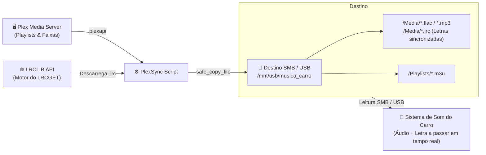

# 🎵 PlexSync — Car Music & Synced Lyrics Exporter

<p align="center">
  
  
  
  
  
</p>

<p align="center">
  <strong>Sincronizador inteligente de playlists do Plex e letras sincronizadas (.lrc) para pens USB e partilhas de rede (SMB), otimizado para sistemas de som de automóveis.</strong>
</p>

---

## 🚀 Sobre o Projeto

O **PlexSync** extrai faixas de música das tuas playlists favoritas do **Plex Media Server** e copia-as para uma pasta de destino (disco USB ou montagem SMB) de onde o sistema de infoentretenimento do carro lê diretamente.

Além de copiar os ficheiros de áudio e criar listas de reprodução em formato `.m3u`, o PlexSync **descarrega automaticamente as letras sincronizadas (`.lrc`)** utilizando o motor do **[LRCLIB](https://lrclib.net)** (a mesma base de dados e API oficial usada pela aplicação **[LRCGET](https://github.com/tranxuanthang/lrcget)**).

### ✨ Funcionalidades Principais

- 🔄 **Sincronização Seletiva:** Exporta apenas as playlists configuradas (ex.: `❤️ Tracks`, `Carro`, `Populares`).
- 🎤 **Letras Sincronizadas (.lrc) Integradas:** 
  - Verifica se já existe um `.lrc` na pasta da biblioteca local do Plex e copia-o diretamente.
  - Se não existir, faz scrape/download automático via **LRCLIB** (o mesmo motor do LRCGET) com timestamps sincronizados com a música (`[MM:SS.xx]`).
  - Não necessita de correr a aplicação gráfica LRCGET à parte.
- 🛡️ **Resiliente a FAT32 / exFAT / NTFS / SMB:** Cópia segura sem erros de permissão (`[Errno 1] Operation not permitted`), contornando limitações de permissões POSIX em discos externos e partilhas.
- ⚡ **Cópia Atómica e Verificação de Integridade:** As faixas e letras são gravadas num ficheiro temporário (`.part`) e só assumidas quando completas. Se o processo for interrompido, na próxima execução o tamanho é verificado e a faixa retomada.
- 📑 **Listas M3U Universais:** Cria ficheiros `.m3u` com caminhos relativos compatíveis com autorrádios e players de automóveis.
- 🧹 **Limpeza Automática:** Remove ficheiros de música ou letras antigas da pasta que já não pertençam a nenhuma das playlists sincronizadas.

---

## 📐 Arquitetura do Fluxo



---

## 📁 Estrutura de Diretórios Gerada

```text
/mnt/usb/musica_carro/
├── Media/
│   ├── 01 Song Name.flac
│   ├── 01 Song Name.lrc     <-- Letra sincronizada lida pelo carro
│   ├── 02 Another Song.mp3
│   └── 02 Another Song.lrc
└── Playlists/
    ├── ❤️ Tracks.m3u
    └── Carro.m3u
```

---

## 🛠️ Instalação e Preparação

### 1. Clonar o Repositório
```bash
git clone https://github.com/teu-utilizador/PlexSync.git
cd PlexSync
```

### 2. Criar e Ativar Ambiente Virtual
```bash
python3 -m venv venv_plex
source venv_plex/bin/activate
```

### 3. Instalar Dependências
```bash
pip install -r requirements.txt
```

---

## ⚙️ Configuração (.env)

Copia o ficheiro de exemplo para `.env`:
```bash
cp .env.example .env
```

Edita o `.env` com as tuas definições:
```env
# URL ou IP do teu servidor Plex
PLEX_URL=http://plex.tbo:32400

# Token de autenticação do Plex
PLEX_TOKEN=o_teu_token_aqui

# Playlists a sincronizar (separadas por vírgula)
PLAYLISTS_TO_SYNC=❤️ Tracks, Carro, Populares

# Pasta raiz de destino (disco USB montado ou partilha SMB)
BASE_TARGET_DIR=/mnt/usb/musica_carro

# Sub-pastas (opcionais)
MEDIA_SUBDIR=Media
PLAYLISTS_SUBDIR=Playlists

# Descarregar letras sincronizadas (.lrc) automaticamente via LRCLIB (o motor do LRCGET)
SYNC_LYRICS=true

# Se não encontrar letra com timestamps, aceita texto simples (predefinido: false)
FALLBACK_PLAIN_LYRICS=false
```

### 🔍 Como obter o Plex Token?
1. Abre o Plex Web no browser e entra num álbum ou música.
2. Clica no menu dos três pontos (`...`) num item e seleciona **Get Info** (Obter informações).
3. Clica em **View XML** no canto inferior esquerdo.
4. Na barra de endereço do URL que abre, procura no final por `X-Plex-Token=...`. Esse valor é o teu token.

---

## ▶️ Execução

Para iniciar a sincronização manual:
```bash
python sync_playlist.py
```

### ⏰ Automatização (Cron Job)
Para manter as músicas e letras do carro sempre atualizadas automaticamente todas as noites às 04:00:

```bash
crontab -e
```

Adiciona a linha:
```cron
0 4 * * * /root/PlexSync/venv_plex/bin/python /root/PlexSync/sync_playlist.py >> /var/log/plexsync.log 2>&1
```

---

## 🛡️ Licença

Distribuído sob a licença MIT. Consulta o ficheiro `LICENSE` para mais informações.
